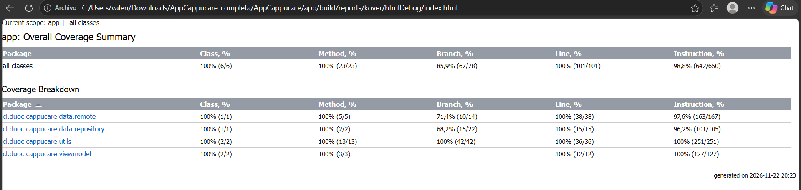
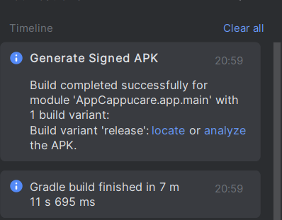
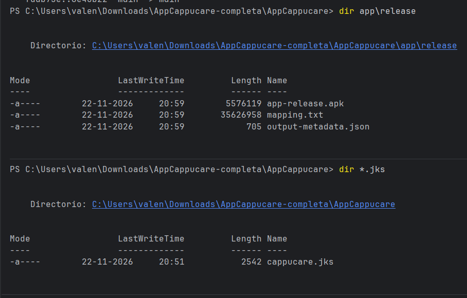
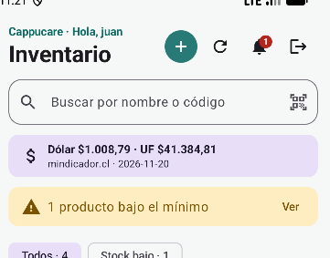

# AppCappucare

App Android para el control de existencias de productos e insumos médicos de **Cappucare**
(caso semestral DSY1105 Desarrollo de Aplicaciones Móviles). Prototipo académico con datos ficticios.

## Integrantes

- Valentina Morales
  

## Repositorios

- App Android: https://github.com/val4nti/Movil-Cappure
- Microservicios (Spring Boot): https://github.com/val4nti/Backend--Cappucare

## Stack

- Kotlin + Jetpack Compose (Material 3)
- Arquitectura MVVM con StateFlow
- Navigation Compose
- Room (SQLite) como caché local de productos y movimientos
- Retrofit + Gson para consumir los microservicios y la API externa
- Backend: 2 microservicios Spring Boot 3 (Java 17) + Spring Data JPA + MySQL
- Pruebas: JUnit 4, kotlinx-coroutines-test y Kover (cobertura)
- DataStore Preferences para la sesión y la configuración de alertas
- Coil para mostrar las fotos de productos

## Funcionalidades

- **Sincronización con el backend:** al abrir el inventario (o con el botón actualizar) la app trae productos y movimientos desde los microservicios y los guarda en Room. Si no hay conexión se muestra un aviso con "Reintentar".
- **Dólar y UF del día:** tarjeta en el inventario con datos de la API externa mindicador.cl.
- **Inicio de sesión** con usuario, contraseña y perfil (Encargado de bodega o Vendedor). La sesión queda guardada.
- **Inventario:** listado con búsqueda por nombre o código, filtro de stock bajo y aviso de productos bajo el mínimo.
- **Detalle de producto:** stock con barra respecto del mínimo, datos del producto, último movimiento y foto.
- **Registrar movimiento:** ingresos y salidas (venta, merma, ajuste) con stock resultante en vivo; se guarda en el microservicio de movimientos, que a su vez actualiza el stock en productos.
- **Historial** de movimientos con filtro por tipo, general o por producto.
- **Alertas de stock:** productos por reponer y opción de recibir notificaciones.
- **Nuevo producto:** formulario con validación por campo; se guarda en el microservicio de productos (POST).
- **Búsqueda por código de barras** escrito a mano con teclado numérico.
- **Reglas por perfil:** el Vendedor no crea productos, no cambia fotos y solo registra salidas.

### Formularios y validaciones

Todas las reglas están en `utils/Validaciones.kt` y se aplican desde los ViewModels. Cada campo con error
muestra borde rojo, ícono de error y mensaje debajo.

### Recursos nativos

| Recurso | Dónde | Permiso |
|---|---|---|
| Cámara | Detalle de producto → "Cámara" | `CAMERA`, pedido en tiempo de ejecución. La foto se guarda con `FileProvider` |
| Galería | Detalle de producto → "Galería" | No necesita permiso (selector de fotos de Android) |
| Notificaciones | Al quedar un producto bajo el mínimo | `POST_NOTIFICATIONS` (Android 13+), pedido en Alertas |

### Animaciones

Transiciones entre pantallas, barra inferior que aparece y desaparece, color animado de los estados de stock,
aviso de stock bajo con `AnimatedVisibility`, lista con `animateItem`, barra de stock con `animateFloatAsState`,
mensaje de éxito animado, cambio de foto con `Crossfade` y pantalla de carga inicial.

## Arquitectura general

```
App Android (Compose + MVVM)
   │  Retrofit
   ├──► productos-service   :8081  ──► MySQL  cappucare_productos
   ├──► movimientos-service :8082  ──► MySQL  cappucare_movimientos
   │         └── llama a productos-service (PUT /stock) para ajustar el stock
   └──► API externa mindicador.cl (dólar y UF)
```

Desde el emulador, el PC se ve en la IP `10.0.2.2`, por eso las URLs base en `RetrofitInstance.kt` son
`http://10.0.2.2:8081/` y `http://10.0.2.2:8082/`.

## Endpoints de los microservicios

### productos-service (puerto 8081)

| Método | Ruta | Descripción |
|---|---|---|
| GET | `/api/productos` | Lista los productos activos |
| GET | `/api/productos/{id}` | Busca un producto por id |
| GET | `/api/productos/codigo/{codigo}` | Busca por código de barras (13 dígitos) |
| GET | `/api/productos/stock-bajo` | Productos con cantidad ≤ stock mínimo |
| POST | `/api/productos` | Crea un producto (409 si el código ya existe) |
| PUT | `/api/productos/{id}` | Actualiza un producto |
| PUT | `/api/productos/{id}/stock` | Ajusta el stock. Body: `{"variacion": -5}` (400 si no hay stock suficiente) |
| DELETE | `/api/productos/{id}` | Elimina un producto (204) |

Ejemplo de body para POST:

```json
{
  "codigo": "7801234567890",
  "nombre": "Guantes de nitrilo",
  "categoria": "Insumos",
  "unidad": "CAJA",
  "cantidad": 12,
  "stockMinimo": 5,
  "activo": true
}
```

### movimientos-service (puerto 8082)

| Método | Ruta | Descripción |
|---|---|---|
| GET | `/api/movimientos?tipo=INGRESO` | Lista movimientos (filtro `tipo` opcional) |
| GET | `/api/movimientos/{id}` | Busca un movimiento |
| GET | `/api/movimientos/producto/{productoId}` | Movimientos de un producto |
| POST | `/api/movimientos` | Registra un ingreso o salida y ajusta el stock en productos-service |
| PUT | `/api/movimientos/{id}` | Actualiza un movimiento |
| DELETE | `/api/movimientos/{id}` | Elimina un movimiento y revierte el stock (204) |

Ejemplo de body para POST:

```json
{ "productoId": 1, "tipo": "SALIDA", "cantidad": 5, "motivo": "Venta", "perfil": "VENDEDOR" }
```

## API externa

- **Servicio:** [mindicador.cl](https://mindicador.cl) (indicadores económicos de Chile, gratuita y sin API key)
- **Endpoint:** `GET https://mindicador.cl/api`
- **Campos usados:** `dolar.valor`, `uf.valor` y `dolar.fecha`
- **En el código:** `IndicadoresApiService` (Retrofit) → `IndicadoresRepository` → `IndicadoresViewModel` → `IndicadoresCard` en la pantalla de Inventario.
- Si no hay internet, la tarjeta muestra el error y un botón "Reintentar" sin que la app se caiga.

## Pruebas unitarias y cobertura

Pruebas en `app/src/test/java/cl/duoc/cappucare` (24 tests):

| Clase de test | Qué prueba |
|---|---|
| `ValidacionesTest` | Reglas de los formularios (código, nombre, cantidades, usuario y contraseña) |
| `FormatoTest` | Formato de pesos chilenos |
| `MapeosTest` | Conversión entre DTO del backend y entidades de Room |
| `IndicadoresRepositoryTest` | Respuesta correcta, error HTTP, sin conexión y respuesta incompleta (API falsa) |
| `IndicadoresViewModelTest` | Estados de carga, éxito y error del ViewModel |

Cobertura medida con **Kover** sobre la lógica (utils, mapeos, repository y viewmodel): **100 % de líneas, 85,9 % de ramas**.
La regla `koverVerifyDebug` exige mínimo 80 %.

```bash
./gradlew testDebugUnitTest      # corre los tests
./gradlew koverHtmlReportDebug   # reporte en app/build/reports/kover/htmlDebug/index.html
./gradlew koverVerifyDebug       # falla si la cobertura baja de 80 %
```



Los microservicios también tienen tests (MockMvc + H2): 10 en productos-service y 7 en movimientos-service (`mvnw test`).

## APK firmado

- Generado con **Build → Generate Signed App Bundle or APK → APK → release**.
- Keystore: `cappucare.jks`, alias `cappucare`, validez 25 años.
- Salida: `app/release/app-release.apk`.





> El archivo `cappucare.jks` y su contraseña no se suben al repositorio por seguridad; quedan guardados por el equipo.

## Capturas



## Estructura

```
cl.duoc.cappucare
├── data
│   ├── local
│   │   ├── entity/        ProductoEntity, MovimientoEntity, MovimientoConProducto
│   │   ├── dao/           ProductoDao, MovimientoDao
│   │   ├── AppDatabase    Base de datos Room (Singleton)
│   │   └── DatosIniciales Catálogo e historial ficticios del primer uso
│   ├── preferences/       PreferenciasRepository (DataStore)
│   └── repository/        InventarioRepository
├── model/                 Estados de UI, errores de formularios y enums
├── navigation/            Rutas y AppNavigation (NavHost + barra inferior)
├── utils/                 Validaciones, GestorImagenes, Notificaciones, Formato
├── viewmodel/             Un ViewModel por pantalla + SesionViewModel compartido
├── ui
│   ├── theme/             Colores y tema Material 3
│   ├── components/        Componentes reutilizables (CampoTexto, selectores, ImagenProducto…)
│   └── screens/           Pantallas, una carpeta por pantalla
└── MainActivity
```

## Cómo ejecutar

1. Abrir la carpeta en Android Studio.
2. Esperar la sincronización de Gradle.
3. Ejecutar en un emulador o dispositivo con Android 11 (API 30) o superior.

`data/remote` contiene los DTO, las interfaces Retrofit (`ProductoApiService`, `MovimientoApiService`,
`IndicadoresApiService`), `RetrofitInstance` y los mapeos DTO ↔ entidad.

## Cómo ejecutar

### 1. Base de datos y microservicios (IntelliJ IDEA)

1. Tener MySQL 8 corriendo en `localhost:3306`. Las bases `cappucare_productos` y `cappucare_movimientos`
   se crean solas (`createDatabaseIfNotExist=true`).
2. Abrir el repositorio del backend en IntelliJ (carpeta con el `pom.xml` padre) con JDK 17.
3. Si MySQL tiene contraseña, ponerla en `spring.datasource.password` de los dos `application.properties`.
4. Ejecutar `ProductosServiceApplication` (puerto 8081) y luego `MovimientosServiceApplication` (puerto 8082).
5. Probar en el navegador: `http://localhost:8081/api/productos`.

### 2. App (Android Studio)

1. Abrir esta carpeta en Android Studio y esperar la sincronización de Gradle.
2. Con los microservicios corriendo, ejecutar la app en el emulador (Android 11 / API 30 o superior).
3. Ingresar con cualquier usuario (3+ caracteres, sin espacios), contraseña (4+ caracteres) y un perfil.
4. El inventario se sincroniza con el backend; la tarjeta de dólar y UF necesita internet.

Para un celular físico: cambiar `10.0.2.2` en `RetrofitInstance.kt` por la IPv4 del PC (`ipconfig`),
estar en la misma red Wi-Fi y permitir los puertos 8081 y 8082 en el firewall de Windows.
